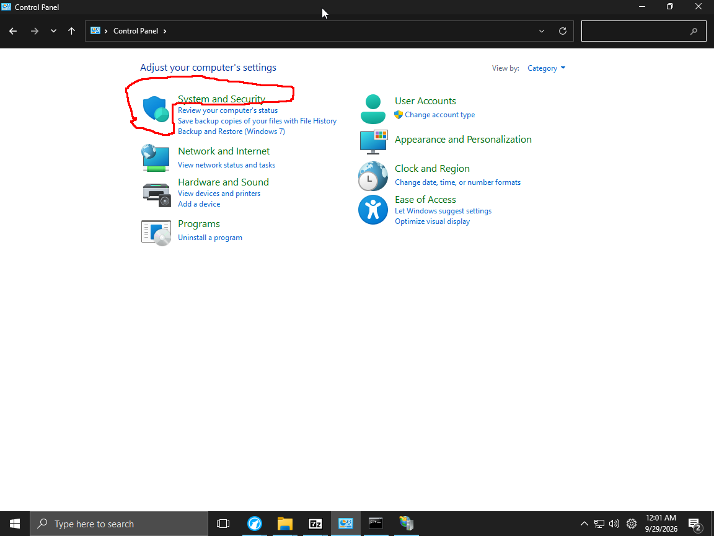
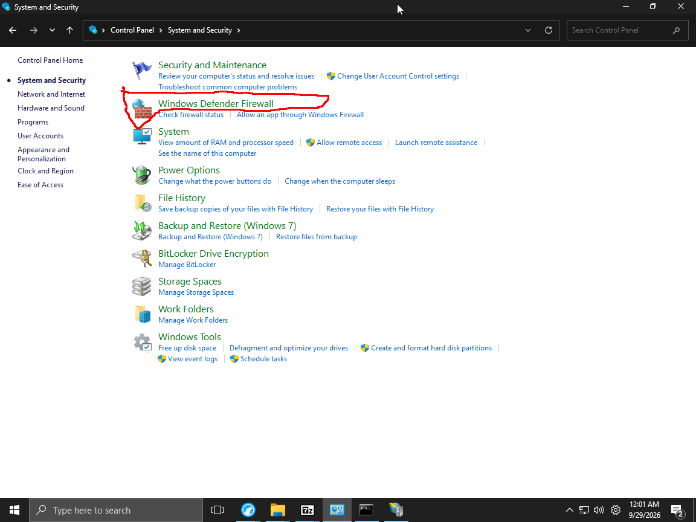
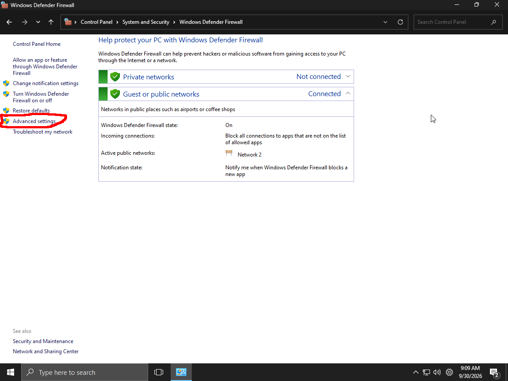
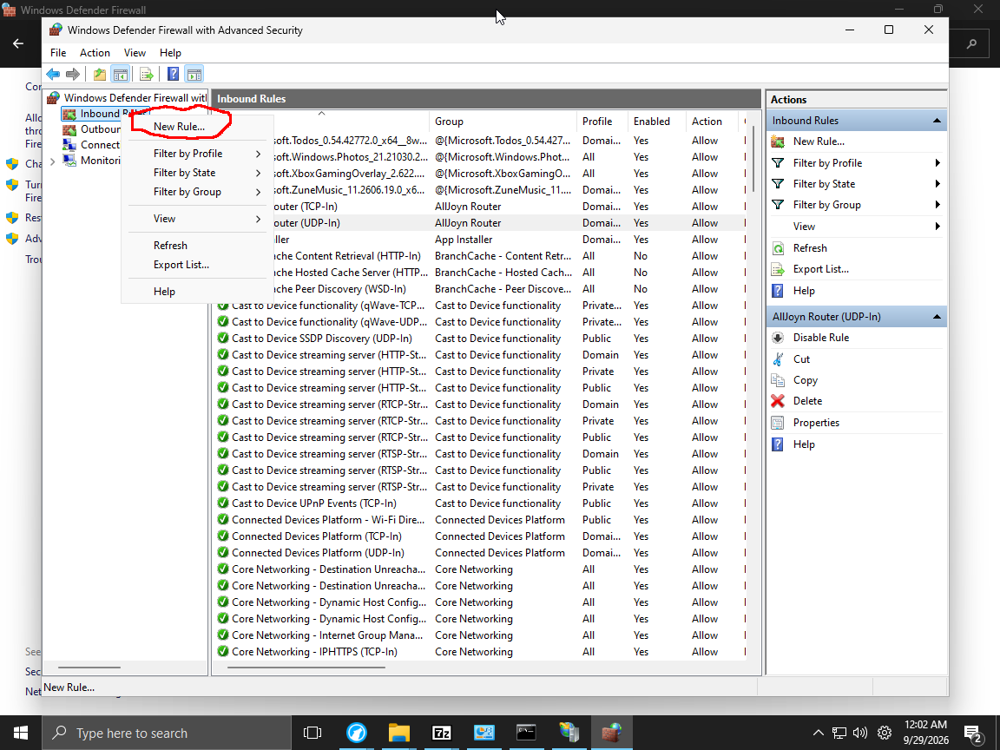
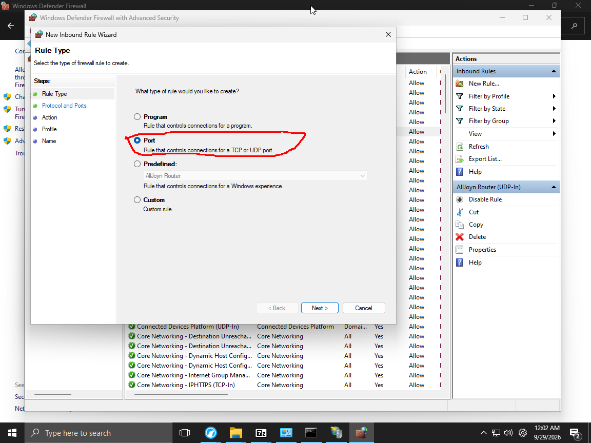
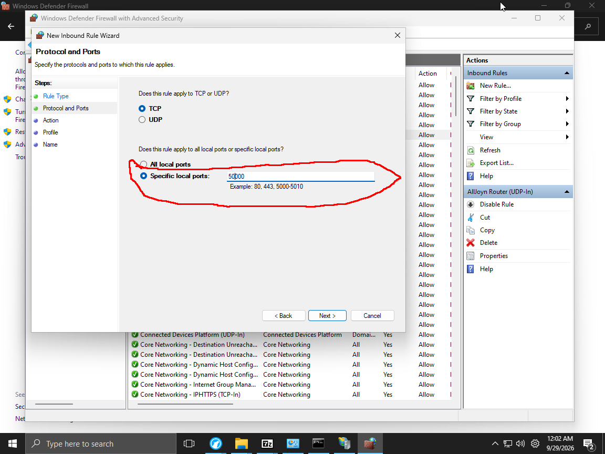
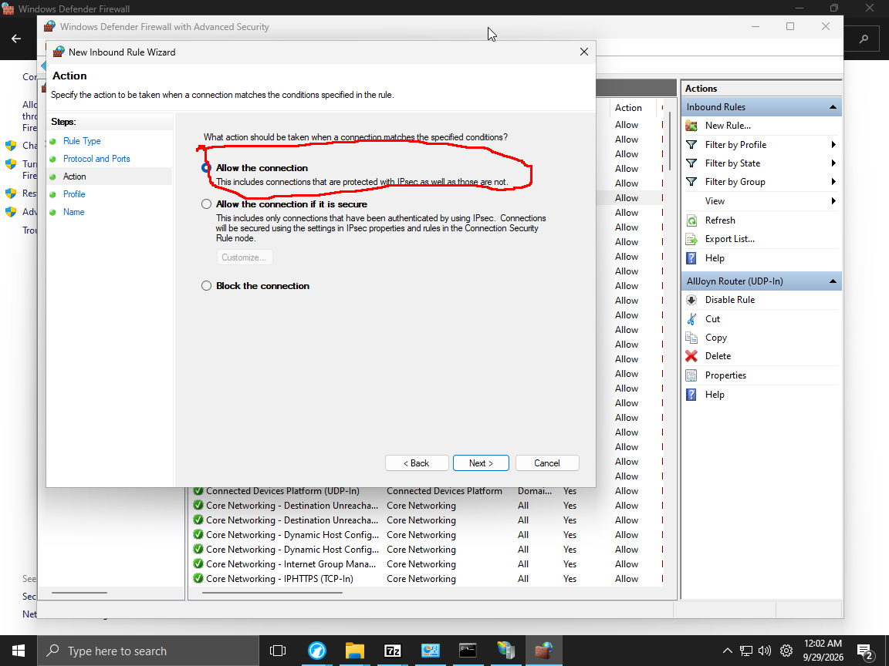
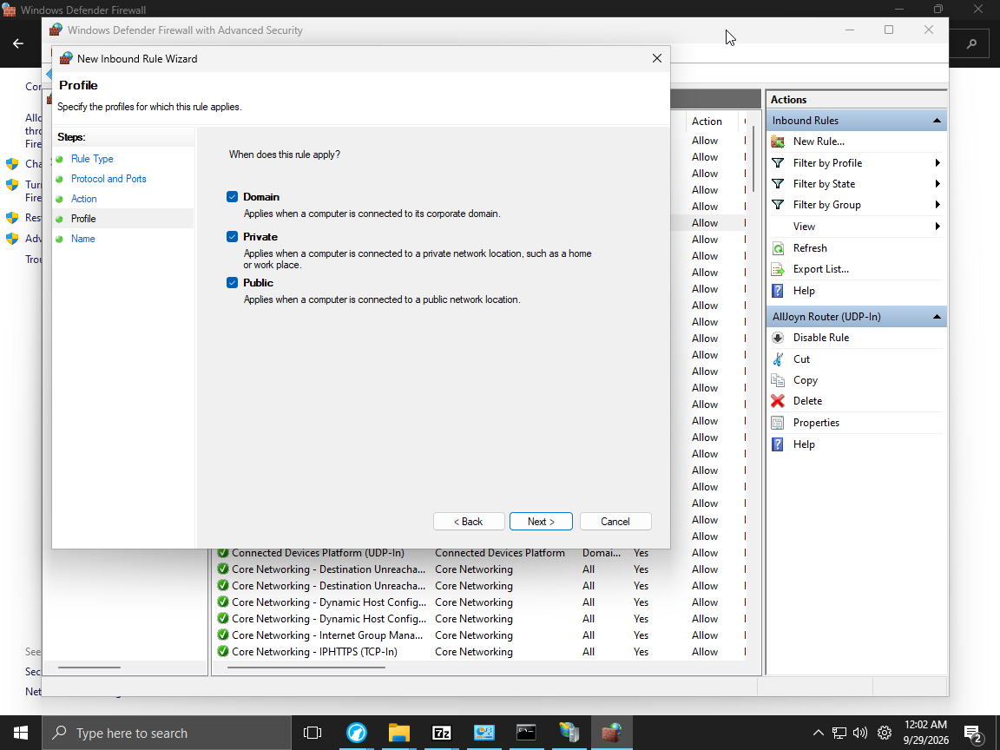
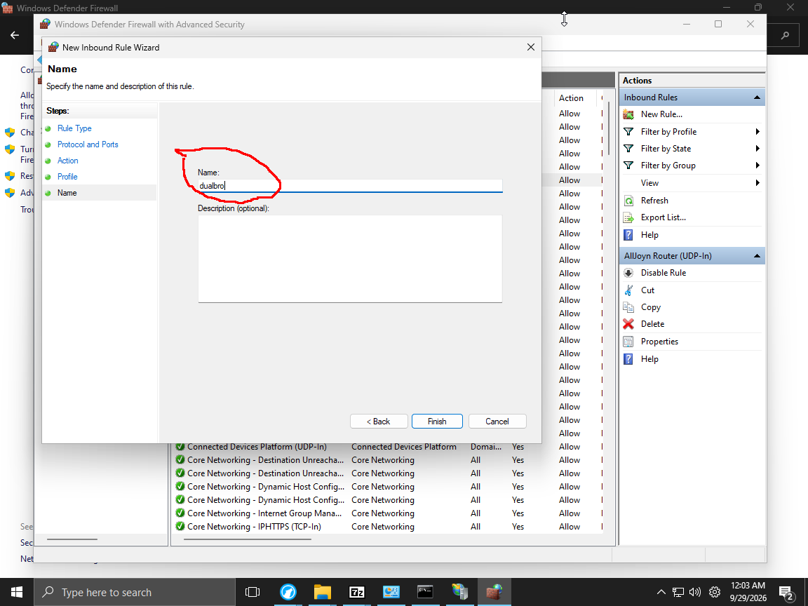

Press Win + R and a pop up would show up

Type control and press ok in the pop up

This control panel would pop up

Click System and Security

Click Windows Defender Firewall or Windows Firewall

(Windows Firewall got renamed to Windows Defender Firewall as some point)

Click Advanced Setting

This pop up would open 

Right-click inbound rule and click new rule

This would pop up :

Select port and click next

Fill in the felid like so and click next

Fill in the felid like so and click next

Fill in the felid like so and click next

Fill in the felid like so and click Finish

