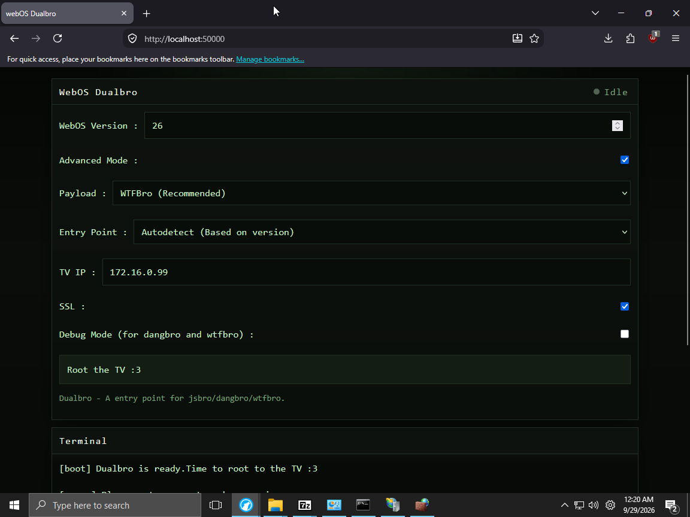
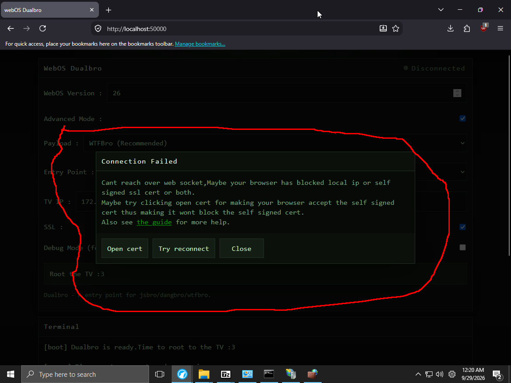

# Windows 
Connect your pc to tv via wifi direct  offline router [A rj45 cable](https://www.youtube.com/watch?v=90gVUkHz3to) ,etc

Setup dualbro offline 

via 

[iis (Hard)](iis/)

or

[msys2 (Easy)](msys2/)

Setup [firewall](firewall/)

Open http://localhost:50000 in your browser

(Fill in your tv ip like so)

Click Root the TV :3

This would pop up

Click open cert and appect the cert

Go to back the localhost tab

Click try reconnect

See your tv

